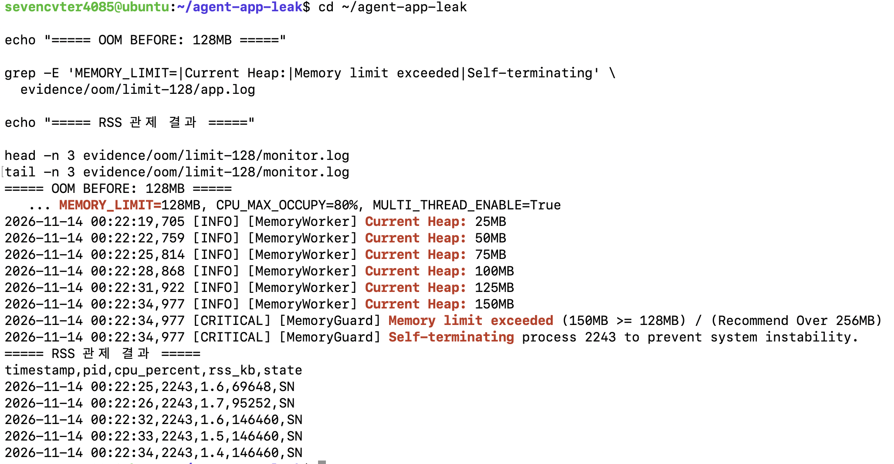
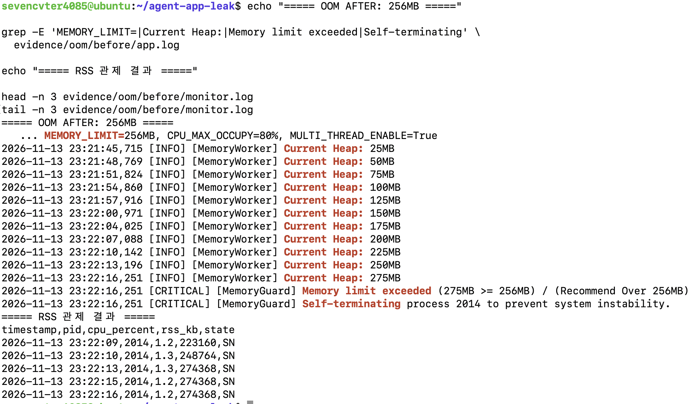

# [Bug] OOM Crash - 메모리 사용량 증가에 따른 MemoryGuard 자체 종료

## 1. Description (현상 설명)

- 대상: Ubuntu 22.04.5 LTS에서 일반 사용자로 실행한 `agent-leak-app-x86`.
- `MEMORY_LIMIT=128`에서 `MemoryWorker`의 Heap 사용량이 증가해 150MB에 도달했을 때 MemoryGuard 제한 초과 메시지와 함께 프로세스가 자체 종료되었습니다.
- `MEMORY_LIMIT`를 256MB로 상향한 뒤에도 같은 유형의 종료가 발생했지만, 종료까지의 시간이 늘어났습니다.
- 이 장애는 Linux 커널 OOM Killer의 동작이 아니라 **애플리케이션 자체 MemoryGuard의 종료**로 관측되었습니다.

## 2. Evidence & Logs (증거 자료)

**Before — `MEMORY_LIMIT=128MB`**

- 실행 로그: [`evidence/oom/before/app.log`](../evidence/oom/before/app.log)
- 메모리 관제: [`evidence/oom/before/monitor.log`](../evidence/oom/before/monitor.log)
- 스크린샷: [`03.oom-before.png`](../evidence/oom/03.oom-before.png)
- 핵심 기록: `MemoryWorker` Heap 약 25MB → 150MB, `[MemoryGuard] Memory limit exceeded (150MB >= 128MB)`, `Self-terminating process 2243`.

**After — `MEMORY_LIMIT=256MB`**

- 실행 로그: [`evidence/oom/after/app.log`](../evidence/oom/after/app.log)
- 메모리 관제: [`evidence/oom/after/monitor.log`](../evidence/oom/after/monitor.log)
- 스크린샷: [`03.oom-after.png`](../evidence/oom/03.oom-after.png)
- 핵심 기록: `MemoryWorker` Heap 약 25MB → 275MB, `[MemoryGuard] Memory limit exceeded (275MB >= 256MB)`, `Self-terminating process 2014`.

**메모리 관측:** `monitor.sh`의 `rss_kb`에서 증가 추세가 확인되었습니다. After 로그에는 RSS 223,160KB → 274,368KB가 기록되어 있습니다. `rss_kb`는 실제 상주 메모리 크기이며, 애플리케이션의 `Current Heap`과 동일한 지표가 아닙니다.

## 3. Root Cause Analysis (원인 분석)

- `MemoryWorker`의 Heap 점유량이 시간에 따라 계속 증가하면서 설정된 `MEMORY_LIMIT`를 넘었습니다. 이는 메모리가 지속적으로 쌓이는 **메모리 누수 양상**으로 판단됩니다. 정확한 객체 참조 및 해제 결함은 실행 로그만으로 특정할 수 없습니다.
- MemoryGuard가 임계치 초과를 감지해 프로세스 자체 종료를 수행했습니다. 따라서 커널의 OOM Killer가 프로세스를 강제 종료했다고 단정할 근거는 없습니다.
- 사용량 한도를 늘려도 누적 증가가 지속되면 같은 장애가 다시 발생할 수 있습니다.

## 4. Workaround & Verification (조치 및 검증)

| 항목 | Before | After |
|---|---|---|
| `MEMORY_LIMIT` | 128MB | 256MB |
| Heap 종료 지점 | 약 150MB | 약 275MB |
| 실행 후 종료까지 | 약 17초 | 약 33초 |
| 최종 결과 | MemoryGuard 자체 종료 | MemoryGuard 자체 종료 (발생 지연) |

- **임시 조치:** `MEMORY_LIMIT`를 128MB에서 256MB로 변경했습니다.
- **검증 결과:** 동일 장애의 발생 시점이 늦춰졌으나, **장애가 완전히 해결된 것은 아닙니다**.
- **추가 개선 방향(제안):** 누적 객체의 참조·해제 흐름 확인, 불필요한 캐시 정리, 장시간 RSS 관측 등을 통한 원인 제거가 필요합니다.
