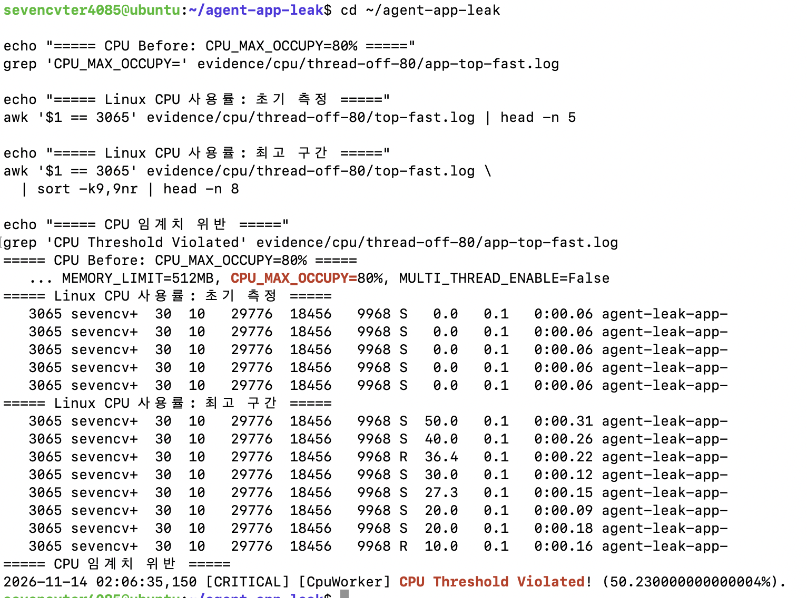
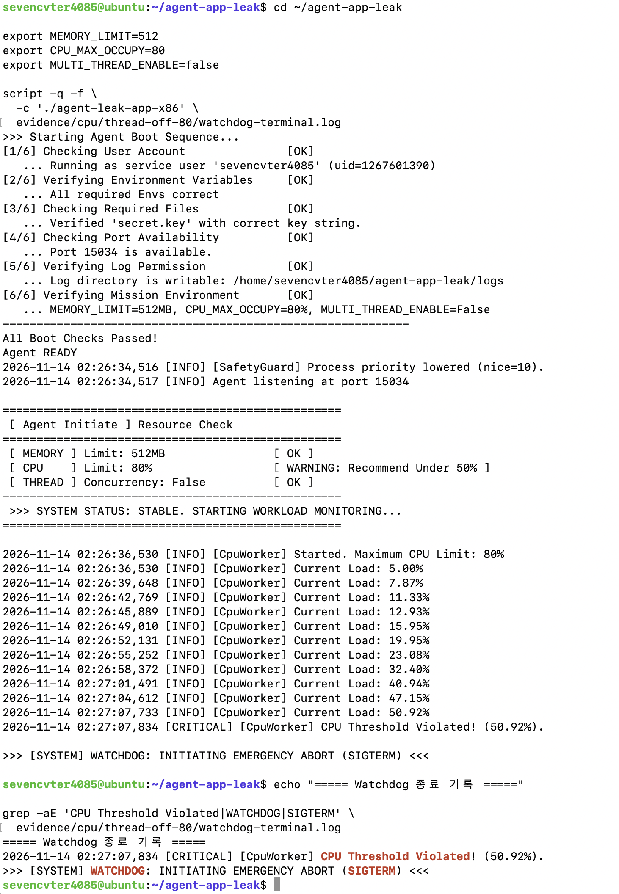
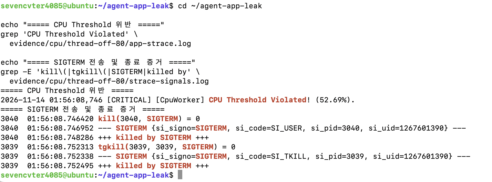

# [Bug] CPU Latency - 내부 CPU 부하 상승 시 Watchdog 긴급 종료(SIGTERM)

## 1. Description (현상 설명)

- 대상: Ubuntu 22.04.5 LTS의 `agent-leak-app-x86`.
- `MEMORY_LIMIT=512`, `CPU_MAX_OCCUPY=80`, `MULTI_THREAD_ENABLE=false` 조건에서 `CpuWorker`의 내부 `Current Load`가 상승하여 `CPU Threshold Violated!` 메시지가 발생했습니다.
- 가상 터미널을 통한 실행에서 `[SYSTEM] WATCHDOG: INITIATING EMERGENCY ABORT (SIGTERM)` 메시지가 확인되었습니다.
- `CPU_MAX_OCCUPY=40`으로 낮춘 경우에는 부하 40% 도달 후 Cooldown을 수행하며 정상 작업을 계속했습니다.

## 2. Evidence & Logs (증거 자료)

**Before — `CPU_MAX_OCCUPY=80%`, `MULTI_THREAD_ENABLE=false`**

- 실행 로그: [`evidence/cpu/before/app.log`](../evidence/cpu/before/app.log)
- 스크린샷: [`04.cpu-before-80%.png`](../evidence/cpu/04.cpu-before-80%25.png)
- 핵심 기록: `[CpuWorker] Current Load: 50.20%` → `[CRITICAL] [CpuWorker] CPU Threshold Violated! (50.199999999999996%).`

**실제 Linux CPU 사용률 급상승(별도 재현 실행)**

- `top` 측정: [`evidence/cpu/before/top-fast.log`](../evidence/cpu/before/top-fast.log)
- 같은 실행의 애플리케이션 로그: [`evidence/cpu/before/app-top-fast.log`](../evidence/cpu/before/app-top-fast.log)
- 스크린샷: [`04.cpu-top-spike.png`](../evidence/cpu/04.cpu-top-spike.png)
- 0.1초 간격 `top`에서 PID 3065의 순간 최고 `%CPU=50.0` 확인.

**Watchdog 긴급 종료(별도 재현 실행)**

- 터미널 기록: [`evidence/cpu/before/watchdog-terminal.log`](../evidence/cpu/before/watchdog-terminal.log)
- 스크린샷: [`04.cpu-watchdog.png`](../evidence/cpu/04.cpu-watchdog.png)
- 핵심 기록: `CPU Threshold Violated! (50.92%)` / `>>> [SYSTEM] WATCHDOG: INITIATING EMERGENCY ABORT (SIGTERM) <<<`.
- `script` 세션 종료 기록: `COMMAND_EXIT_CODE="143"`.

**SIGTERM 시스템 호출 추적(별도 재현 실행)**

- 추적 로그: [`evidence/cpu/before/strace-signals.log`](../evidence/cpu/before/strace-signals.log)
- 같은 실행의 애플리케이션 로그: [`evidence/cpu/before/app-strace.log`](../evidence/cpu/before/app-strace.log)
- 스크린샷: [`04.cpu-sigterm.png`](../evidence/cpu/04.cpu-sigterm.png)
- 핵심 기록: `3040 kill(3040, SIGTERM) = 0` → `3040 +++ killed by SIGTERM +++`.

**After — `CPU_MAX_OCCUPY=40%`, `MULTI_THREAD_ENABLE=false`**

- 실행 로그: [`evidence/cpu/after/app.log`](../evidence/cpu/after/app.log)
- 스크린샷: [`04.cpu-after-40%.png`](../evidence/cpu/04.cpu-after-40%25.png)
- 핵심 기록: `[CpuWorker] Peak reached (40.00%). Starting cooldown...`, `[CpuWorker] Cooldown complete (5.00%). Resuming load increase...`가 반복되며 작업을 계속 진행함.

**증거 해석 주의:** `Current Load`는 애플리케이션 내부 지표이고 `top`의 `%CPU`는 OS 측정값이므로 직접 동일시하지 않습니다. `top` 급상승, Watchdog 메시지, SIGTERM 추적은 **각기 다른 재현 실행**에서 수집되었습니다.

## 3. Root Cause Analysis (원인 분석)

- `CPU_MAX_OCCUPY=80%` 조건에서는 내부 부하가 50%를 조금 넘은 시점에 임계치 위반 및 긴급 종료가 반복 관측되었습니다. 부트 로그에는 `WARNING: Recommend Under 50%`가 출력됩니다. 따라서 허용 설정값 80%가 프로그램의 약 50% 보호 기준보다 높아 종료 경로에 진입한 것으로 해석됩니다.
- Watchdog 긴급 종료 메시지는 일반 로그 파일 리다이렉션에서 누락되었으나, `script -q -f`로 터미널 출력을 기록하자 확인되었습니다. 출력 버퍼링이 원인일 가능성이 높습니다.
- `strace`의 `kill(3040, SIGTERM)` 및 수신 신호 기록으로 **프로세스 내부의 SIGTERM 자체 전송 및 종료**를 확인했습니다. 별도 외부 Watchdog 프로세스의 존재를 의미하지는 않습니다.
- 1초 간격 `top`의 최고 사용률은 5.0%였으나 0.1초 간격에서는 순간 50.0%를 관측했습니다. 이는 단기간 CPU 급상승이 긴 샘플링 구간에서 희석될 수 있음을 보여줍니다. 80% 초과 또는 장시간 CPU 포화는 입증되지 않았습니다.

## 4. Workaround & Verification (조치 및 검증)

| 항목 | Before | After |
|---|---|---|
| `MEMORY_LIMIT` | 512MB | 512MB |
| `MULTI_THREAD_ENABLE` | false | false |
| `CPU_MAX_OCCUPY` | 80% | 40% |
| 내부 CPU 동작 | 약 50% 초과 시 Threshold 위반 | 40% 도달 시 Cooldown 후 5% 부근으로 복귀 |
| 프로세스 결과 | Watchdog 긴급 종료(SIGTERM) 관측 | Cooldown 반복, 작업 계속 진행 |

- **임시 조치:** `CPU_MAX_OCCUPY`를 80%에서 40%로 낮추어 내부 보호 임계치에 도달하기 전에 Cooldown을 수행하도록 설정했습니다.
- **검증 결과:** Before는 CPU 임계치 위반으로 종료되었고, After는 여러 차례 Cooldown 후에도 정상 동작을 지속했습니다.
- **추가 개선 방향(제안):** OS CPU 사용률과 내부 `Current Load` 지표를 구분해 모니터링하고, Watchdog 종료 원인과 신호를 일관되게 로깅하도록 개선할 필요가 있습니다.
