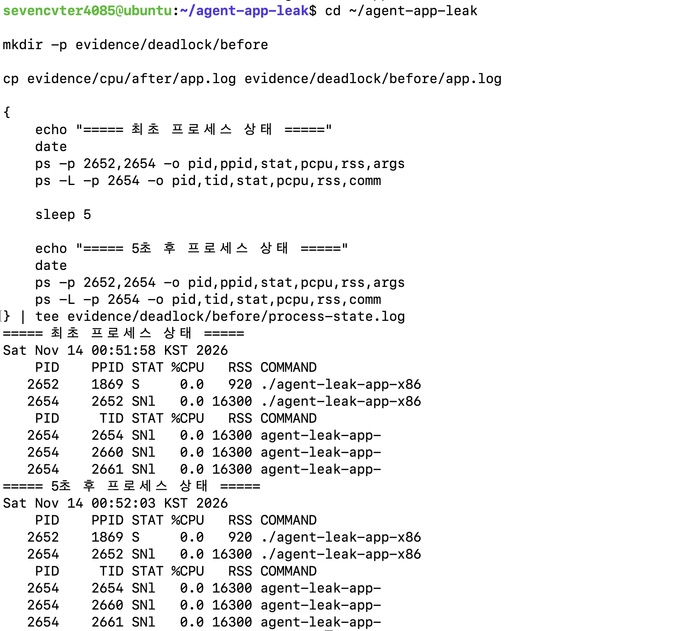
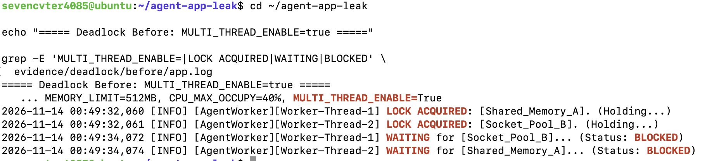
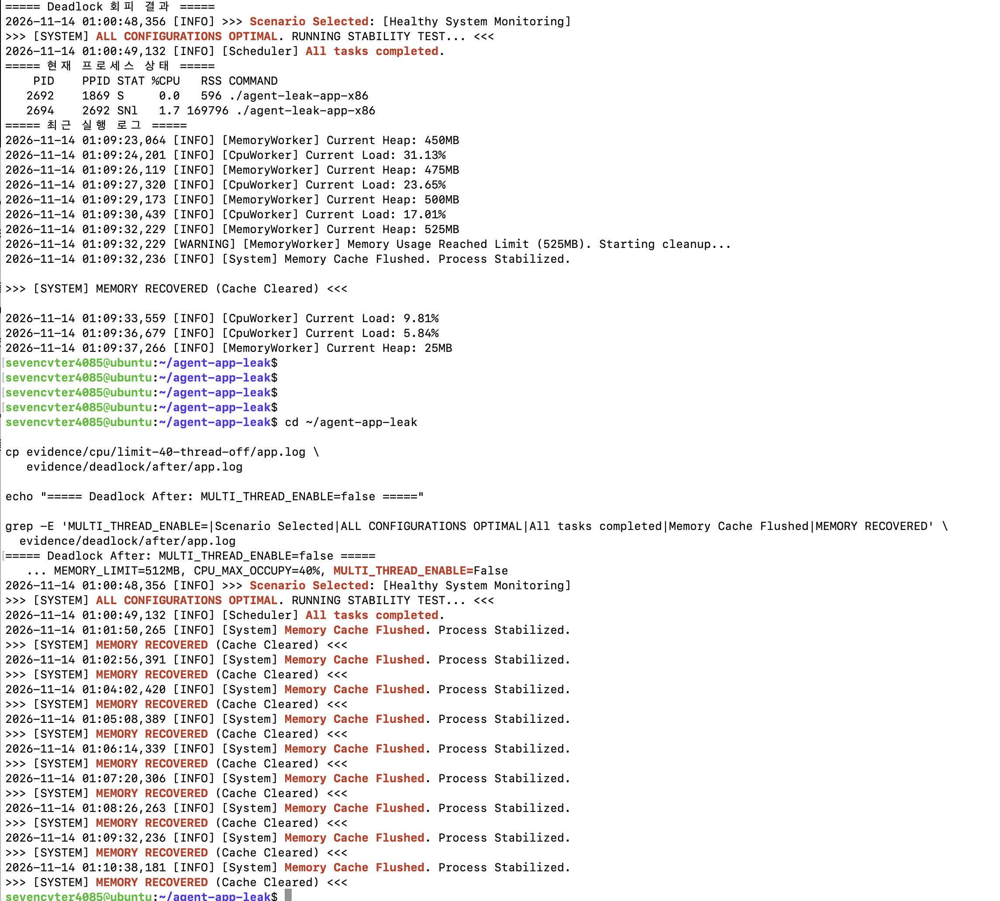

# [Bug] Deadlock - 멀티스레드 자원 순환 대기로 인한 프로세스 무응답

## 1. Description (현상 설명)

- 대상: Ubuntu 22.04.5 LTS의 `agent-leak-app-x86`.
- `MEMORY_LIMIT=512`, `CPU_MAX_OCCUPY=40`, `MULTI_THREAD_ENABLE=true` 조건에서 두 작업 스레드가 각각 다른 자원을 점유한 채 서로의 자원을 대기했습니다.
- 프로세스는 종료되지 않고 살아 있었지만 CPU 사용률이 0%에 머물고 메모리 사용량도 변하지 않아 작업 진행이 정체되었습니다.

## 2. Evidence & Logs (증거 자료)

**Before — `MULTI_THREAD_ENABLE=true`**

- 애플리케이션 로그: [`evidence/deadlock/before/app.log`](../evidence/deadlock/before/app.log)
- 프로세스 관측 로그: [`evidence/deadlock/before/process-state.log`](../evidence/deadlock/before/process-state.log)
- 스크린샷: [`05.deadlock-process-before.png`](../evidence/deadlock/05.deadlock-process-before.png), [`05.deadlock-before-blocked.png`](../evidence/deadlock/05.deadlock-before-blocked.png)
- 로그 근거:
  - `[Worker-Thread-1] LOCK ACQUIRED: [Shared_Memory_A]. (Holding...)`
  - `[Worker-Thread-2] LOCK ACQUIRED: [Socket_Pool_B]. (Holding...)`
  - `[Worker-Thread-1] WAITING for [Socket_Pool_B]... (Status: BLOCKED)`
  - `[Worker-Thread-2] WAITING for [Shared_Memory_A]... (Status: BLOCKED)`
- 프로세스 상태(2026-11-14 00:51:58 및 00:52:03 KST): 부모 PID 2652, 자식 PID 2654 모두 유지, CPU 0.0%, 부모 RSS 920KB / 자식 RSS 16,300KB 동일.
- `ps -L`에서 자식 스레드 TID 2654, 2660, 2661이 5초 후에도 유지되었습니다.

**After — `MULTI_THREAD_ENABLE=false`**

- 애플리케이션 로그: [`evidence/deadlock/after/app.log`](../evidence/deadlock/after/app.log)
- 스크린샷: [`05.deadlock-after.png`](../evidence/deadlock/05.deadlock-after.png)
- 주요 기록: `Scenario Selected: [Healthy System Monitoring]`, `[Scheduler] All tasks completed.`, `[System] Memory Cache Flushed. Process Stabilized.`, `[SYSTEM] MEMORY RECOVERED (Cache Cleared)`.

## 3. Root Cause Analysis (원인 분석)

- Thread 1은 `Shared_Memory_A`를 점유한 채 `Socket_Pool_B`를 기다렸고, Thread 2는 `Socket_Pool_B`를 점유한 채 `Shared_Memory_A`를 기다렸습니다.
- 이는 서로 다른 락을 점유한 상태에서 상대 스레드가 보유한 락을 기다리는 **순환 대기(Circular Wait)** 구조입니다. 자원 상호 배제, 점유 대기, 순환 대기가 로그에 나타나며, 락 해제가 이루어지지 않아 두 스레드가 진행되지 못한 것으로 해석됩니다.
- 프로세스가 살아 있고 CPU 사용량이 거의 없다는 사실만으로 Deadlock을 확정할 수는 없지만, 두 스레드의 `WAITING/BLOCKED`와 서로 반대 방향의 락 의존 관계가 함께 확인되어 교착상태로 판단했습니다.

## 4. Workaround & Verification (조치 및 검증)

| 항목 | Before | After |
|---|---|---|
| `MEMORY_LIMIT` | 512MB | 512MB |
| `CPU_MAX_OCCUPY` | 40% | 40% |
| `MULTI_THREAD_ENABLE` | true | false |
| 작업 상태 | 상호 락 대기 및 작업 정체 | Scheduler 전체 작업 완료 |
| 프로세스 상태 | PID 유지, CPU·RSS 정체 | 정상 작업 진행 및 메모리 회복 로그 확인 |

- **임시 조치:** `MULTI_THREAD_ENABLE=true`를 `false`로 변경하여 동시 처리 모드를 비활성화했습니다.
- **검증 결과:** Before에서는 교착상태가 발생했고 After에서는 Scheduler 작업이 정상 완료되었으므로 설정 변경에 따른 회피 효과를 확인했습니다.
- **추가 개선 방향(제안):** 모든 스레드에서 락 획득 순서를 일치시키고, 락 획득 제한시간 및 실패 시 복구 경로를 적용해야 합니다.
